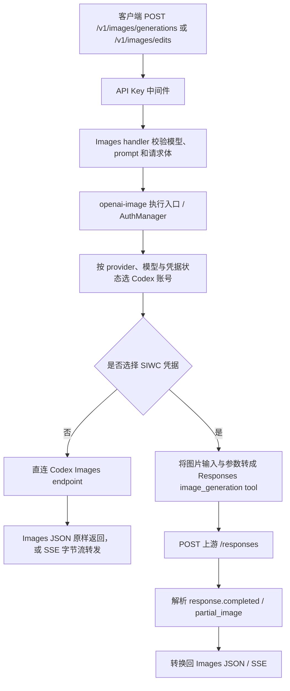

# EasyCLIProxyAPI 的 Codex 图像请求完整链路

## 版本范围

EasyCLIProxyAPI 在 [commit 1d5198e](https://github.com/router-for-me/EasyCLIProxyAPI/commit/1d5198eb672a0e0e3257a275bd2b9e42951dbdeb) 将配套内核更新到 CLIProxyAPI v8.0.38。EasyCLIProxyAPI 是管理界面，实际 HTTP 路由、图像协议转换和 Codex 上游请求由 CLIProxyAPI 内核执行；以下先按这个打包版本追踪。[EasyCLIProxyAPI README](https://github.com/router-for-me/EasyCLIProxyAPI/blob/1d5198eb672a0e0e3257a275bd2b9e42951dbdeb/README.md#L10-L27)

另外单独标出 2026-10-23 的 CLIProxyAPI main commit [d946c4f](https://github.com/router-for-me/CLIProxyAPI/commit/d946c4fba6fc9a5cfbca1f3d85184d62ad2fb683)：它新增了按请求识别 Codex 客户端的 SIWC 选择规则。该行为不应误认为 EasyCLIProxyAPI 上述 v8.0.38 打包快照。

## 总览

客户端调用的是 OpenAI Images API。正常 Codex 凭据走上游 Codex Images endpoint；使用 SIWC 凭据时，内核才回退到 Responses 的 image_generation 工具协议，再把结果转换回 Images API 格式。也就是说，Responses 在回退分支里是代理到上游的内部协议，不是客户端必须调用的接口。

路由注册了带请求认证中间件的 POST /v1/images/generations 和 POST /v1/images/edits；相同路由表也注册 /v1/responses，但图像 handler 与之分开。[路由注册](https://github.com/router-for-me/CLIProxyAPI/blob/v8.0.38/internal/api/server_routes.go#L55-L95)

## 1. 客户端入口与校验

- generations 接受 JSON；缺少 model 时默认 gpt-image-2，prompt 必须非空，response_format 默认 b64_json，stream 决定是否使用流式路径。Codex 图像模型进入 routed image 执行分支。[generations handler](https://github.com/router-for-me/CLIProxyAPI/blob/v8.0.38/sdk/api/handlers/openai/openai_images_handlers.go#L685-L789)
- Codex 图像模型名单包含 gpt-image-1.5、gpt-image-2、gpt-image-2.5、gpt-image-2.5-flare 和 gpt-image-2.5-sunburst；非图片接口请求这些模型会被拒绝。[模型校验](https://github.com/router-for-me/CLIProxyAPI/blob/v8.0.38/sdk/api/handlers/openai/openai_images_handlers.go#L275-L312) [图片模型接口限制](https://github.com/router-for-me/CLIProxyAPI/blob/v8.0.38/sdk/api/handlers/handlers_routing.go#L235-L256)
- edits 接受 JSON 或 multipart/form-data。multipart 要有 prompt 和 image/image[] 文件，handler 会保留表单字段和文件交给执行层。[edits handler](https://github.com/router-for-me/CLIProxyAPI/blob/v8.0.38/sdk/api/handlers/openai/openai_images_handlers.go#L791-L898) [JSON edits handler](https://github.com/router-for-me/CLIProxyAPI/blob/v8.0.38/sdk/api/handlers/openai/openai_images_handlers.go#L982-L1118)

## 2. Provider、模型与账号选择

图片 handler 以 openai-image 执行协议调用 ExecuteImageWithAuthManager。执行层把原始 model、endpoint path、请求体和来源协议放进执行请求及 metadata，再由 AuthManager.Execute 或 ExecuteStream 选凭据并调用对应 provider executor。[图片执行入口](https://github.com/router-for-me/CLIProxyAPI/blob/v8.0.38/sdk/api/handlers/openai/openai_images_handlers.go#L1249-L1300) [执行请求与 metadata](https://github.com/router-for-me/CLIProxyAPI/blob/v8.0.38/sdk/api/handlers/handlers_execution.go#L38-L120)

默认路由通过注册模型查 provider；图片专用模型只允许通过 images 路径。多 provider 情况下，Manager 会轮换 provider 起始顺序；账号选择、冷却和重试由 AuthManager 的 retry policy 管理，Codex 图片 executor 本身不实现账号轮询。[provider/model 路由](https://github.com/router-for-me/CLIProxyAPI/blob/v8.0.38/sdk/api/handlers/handlers_routing.go#L125-L163) [AuthManager 重试循环](https://github.com/router-for-me/CLIProxyAPI/blob/v8.0.38/sdk/cliproxy/auth/conductor_execution.go#L120-L179) [凭据尝试](https://github.com/router-for-me/CLIProxyAPI/blob/v8.0.38/sdk/cliproxy/auth/conductor_execution.go#L483-L630)

v8.0.38 中，Codex 凭据的 use_siwc 标志决定使用嵌套 siwc.access_token，还是普通 api_key/access_token；SIWC 默认 base URL 是 https://api.openai.com/v1。普通 Codex 账号缺少自定义 base_url 时默认使用 https://chatgpt.com/backend-api/codex。[SIWC 识别与 token](https://github.com/router-for-me/CLIProxyAPI/blob/v8.0.38/internal/runtime/executor/codex_executor_auth.go#L23-L69) [token 与 base URL 解析](https://github.com/router-for-me/CLIProxyAPI/blob/v8.0.38/internal/runtime/executor/codex_executor_auth.go#L464-L487)

## 3. CodexExecutor 的分支

执行器根据 source format 和 request path 识别 Images 请求，再进入专用的 executeOpenAIImage / executeOpenAIImageStream。[执行入口](https://github.com/router-for-me/CLIProxyAPI/blob/v8.0.38/internal/runtime/executor/codex_executor_execute.go#L21-L29) [Images 请求识别与 SIWC 分支](https://github.com/router-for-me/CLIProxyAPI/blob/v8.0.38/internal/runtime/executor/codex_openai_images.go#L58-L95)

### A. 普通 Codex 凭据：直接调用 Images API

- 若不是 SIWC，且 model/path 是已识别的 Codex 图像模型，generations 映射为 /images/generations，edits 映射为 /images/edits；base URL 默认是 https://chatgpt.com/backend-api/codex。因此默认上游分别是 https://chatgpt.com/backend-api/codex/images/generations 和 .../images/edits。[endpoint 选择](https://github.com/router-for-me/CLIProxyAPI/blob/v8.0.38/internal/runtime/executor/codex_openai_images.go#L502-L514) [默认 base URL 与请求构造](https://github.com/router-for-me/CLIProxyAPI/blob/v8.0.38/internal/runtime/executor/codex_openai_images.go#L333-L368)
- generations 保留 OpenAI Images JSON 参数并确保模型名和 stream 设置正确。edits 的 JSON payload 继续走 JSON；multipart 会解析后改成 JSON，把 image/image[] 及 mask 文件编码成 data URL，同时保留 prompt、size、quality 等表单字段。[direct payload 准备](https://github.com/router-for-me/CLIProxyAPI/blob/v8.0.38/internal/runtime/executor/codex_openai_images.go#L516-L550) [multipart edits 转换](https://github.com/router-for-me/CLIProxyAPI/blob/v8.0.38/internal/runtime/executor/codex_openai_images.go#L553-L617)
- 上游请求使用所选 Codex 凭据的 Bearer token、Codex headers 和代理配置；direct Images 路径会移除客户端传入的 User-Agent。[direct headers](https://github.com/router-for-me/CLIProxyAPI/blob/v8.0.38/internal/runtime/executor/codex_executor_request.go#L188-L200) [direct 请求、日志与响应](https://github.com/router-for-me/CLIProxyAPI/blob/v8.0.38/internal/runtime/executor/codex_openai_images.go#L333-L397)
- 非流式成功响应的 Images JSON 直接返回给客户端。stream=true 时，执行器从上游读取字节块并向下游转发，不做 Responses 事件转换；上游非 2xx 会映射为带状态码的 Codex 错误。[非流执行](https://github.com/router-for-me/CLIProxyAPI/blob/v8.0.38/internal/runtime/executor/codex_openai_images.go#L333-L398) [直连流执行](https://github.com/router-for-me/CLIProxyAPI/blob/v8.0.38/internal/runtime/executor/codex_openai_images.go#L400-L500)

### B. SIWC 凭据：Responses 工具回退

- SIWC 会跳过 direct Images endpoint，handler 先把图像请求变成 Responses 请求：顶层 model 使用 gpt-image-2-base-model 配置，默认 gpt-5.4-mini；tools[].model 保留请求指定的图像模型（例如 gpt-image-2），tool 为 image_generation，action 为 generate 或 edit。输入图片转成 Responses input_image，stream=true、store=false。[回退分支](https://github.com/router-for-me/CLIProxyAPI/blob/v8.0.38/internal/runtime/executor/codex_openai_images.go#L87-L127) [图像工具与顶层请求构造](https://github.com/router-for-me/CLIProxyAPI/blob/v8.0.38/internal/runtime/executor/codex_openai_images.go#L775-L974)
- 因此，先前出现“gpt-5.4-mini 不受支持”的 400 与该回退分支相符：顶层模型是 gpt-5.4-mini，而图像模型只在 tools[].model 中。结合那条日志，这是分支路径的推断；direct Images 分支不会把 gpt-5.4-mini 设为顶层模型。[基础模型默认值](https://github.com/router-for-me/CLIProxyAPI/blob/v8.0.38/internal/runtime/executor/codex_openai_images.go#L73-L85)
- 该分支向所选凭据的 base URL 发 POST /responses。非流式路径读取 SSE 内容，收集 response.output_item.done 并在 response.completed 中提取 image_generation_call.result，随后生成 Images API 的 created/data/b64_json 响应；response_format=url 会被表示为 data:...;base64 URL。[回退非流与解析](https://github.com/router-for-me/CLIProxyAPI/blob/v8.0.38/internal/runtime/executor/codex_openai_images.go#L87-L188) [结果提取与 Images JSON](https://github.com/router-for-me/CLIProxyAPI/blob/v8.0.38/internal/runtime/executor/codex_openai_images.go#L1017-L1127)
- 流式路径读取 Responses SSE 行，将 response.image_generation_call.partial_image 转成 image_generation.partial_image，将 completed 图像转成 image_generation.completed；edit 对应 image_edit 前缀。没有完成事件或没有图像结果会产生上游错误。[Responses SSE 到图像 SSE](https://github.com/router-for-me/CLIProxyAPI/blob/v8.0.38/internal/runtime/executor/codex_openai_images.go#L255-L330) [SSE 帧格式](https://github.com/router-for-me/CLIProxyAPI/blob/v8.0.38/internal/runtime/executor/codex_openai_images.go#L1026-L1172)
- EasyCLIProxyAPI 的图像设置页把 disable-image-generation 和 gpt-image-2-base-model 暴露为内核配置；基础模型配置用于上述回退路径。UI 当前展示的默认值是 gpt-5.4-mini。[设置字段](https://github.com/router-for-me/EasyCLIProxyAPI/blob/1d5198eb672a0e0e3257a275bd2b9e42951dbdeb/src/services/generalTemplateFields.ts#L56-L64) [内核配置字段映射](https://github.com/router-for-me/EasyCLIProxyAPI/blob/1d5198eb672a0e0e3257a275bd2b9e42951dbdeb/src-tauri/src/core_config/extended.rs#L107-L117)

## 4. 错误、重试与最近一次失败

- 非流式 direct 请求在收到 HTTP 响应后先记录状态码和响应头，再 io.ReadAll 响应体。若 body 读取失败，会记录读取错误并立即返回，尚未进入非 2xx 检查或 Images 响应构造；fallback Responses 非流式读取也会在解析 SSE 前返回读取错误。[direct body 读取顺序](https://github.com/router-for-me/CLIProxyAPI/blob/v8.0.38/internal/runtime/executor/codex_openai_images.go#L382-L397) [Responses body 读取错误](https://github.com/router-for-me/CLIProxyAPI/blob/v8.0.38/internal/runtime/executor/codex_openai_images.go#L142-L148)
- 这种错误返回到 AuthManager，由统一错误映射包装；具体是否换账号重试，取决于 Manager 对错误类别、冷却和重试设置的判断。若 direct 流式响应 body 在 HTTP 200 后中途读取失败，执行器会将 read error 作为 stream chunk error 交给 handler，handler 在流已开始时以 SSE error 事件向客户端报告；不会由该读取循环重放已开始的图像请求。[流读取错误](https://github.com/router-for-me/CLIProxyAPI/blob/v8.0.38/internal/runtime/executor/codex_openai_images.go#L471-L495) [下游流错误转发](https://github.com/router-for-me/CLIProxyAPI/blob/v8.0.38/sdk/api/handlers/openai/openai_images_handlers.go#L1322-L1367) [错误响应映射](https://github.com/router-for-me/CLIProxyAPI/blob/v8.0.38/sdk/api/handlers/handlers_execution.go#L348-L397)
- 最近日志的 gpt-image-2 请求返回 502，耗时约 180.2 秒；日志显示上游先给 HTTP 200，随后读取 body 时 TLS 对端未发送 close_notify，连接提前结束。这与“已收到状态与响应头，但完整 body/SSE 尚未读完”的错误路径相符。它无法单独证明图片是否已生成或上游是否已计费。

## 5. v8.0.38 与 CLIProxyAPI main 的 SIWC 差别

v8.0.38 的分支只读账户的 use_siwc 标记。后续 main commit d946c4f 使用 IsCodexUseSIWCForRequest：来自 Codex 客户端的请求忽略该账户标记，改用普通 Codex 凭据；其他请求仍按 SIWC 标记选择。这改变了分支判定条件，但 Images handler、direct endpoint 与 Responses fallback 的总体链路保持可辨认。[main 图片分支](https://github.com/router-for-me/CLIProxyAPI/blob/d946c4fba6fc9a5cfbca1f3d85184d62ad2fb683/internal/runtime/executor/codex_openai_images.go#L87-L95) [main 请求感知的 SIWC 判定](https://github.com/router-for-me/CLIProxyAPI/blob/d946c4fba6fc9a5cfbca1f3d85184d62ad2fb683/sdk/cliproxy/auth/types.go#L893-L899)
